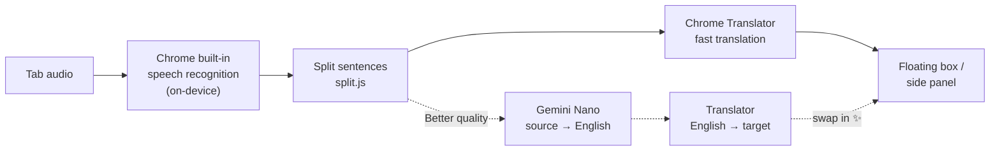

# 🎧 FreeLiveSub

**Free, 100% on-device live translated subtitles: turn the audio of any tab into bilingual "original + translation" subtitles.**

**Floating subtitle box**, **18 source × 39 target languages**, **Better-quality mode (Gemini Nano)**, **save questionable lines**, **Japanese-style themes**, and an interface in six languages.

[](manifest.json)
[](#-requirements)
[](#-privacy)
[](LICENSE)
[](#-interface-languages)

[繁體中文](README.md) · **English** · [日本語](README.ja.md) · [简体中文](README.zh-Hans.md) · [한국어](README.ko.md) · [Español](README.es.md)

[Why](#-why) · [Features](#-features) · [How it works](#-how-it-works) · [Install](#-install) · [Usage](#-usage) · [Requirements](#-requirements) · [Known limitations](#-known-limitations) · [Privacy](#-privacy) · [Similar projects](#-similar-projects) · [Development](#-development)

---

## 💡 Why

I watch a lot of Japanese and English videos and live streams, and I rely on live subtitles. But almost every live-translation tool I found was paid, required an account, or sent my audio to someone else's server. So I built my own.

FreeLiveSub uses only **Chrome's built-in speech recognition and translation**, and everything runs on your computer:

> [!NOTE]
> **No account, no API key, no server, and no fees.** Audio and text never leave your computer.

## ✨ Features

- **Works on any tab**: YouTube, niconico, live streams, web meetings… If the tab plays audio, click the toolbar icon and subtitles start.
- **Floating subtitle box**: drag it, resize it from any corner, and it stays visible in fullscreen. Scroll up to see the last 50 lines.
- **Many languages**: 18 source languages (Japanese, English, Chinese, Korean, Spanish, French, German…) × 39 target languages. What actually works depends on your Chrome; the side panel marks each one ✓ downloaded / ⬇ downloadable / ✕ not supported.
- **Long-sentence splitting**: recognized text has no punctuation and several sentences often run together. FreeLiveSub splits them before translating so it doesn't stop after the first sentence (with dedicated rules for Japanese).
- **Better-quality mode ✨**: shows the fast translation first, then re-translates finished lines with Gemini Nano and swaps them in. It handles casual speech and context better.
- **Save questionable lines ⭐**: check them in Google Translate or DeepL with one click, copy them as an AI prompt (with the preceding lines), or jump back to that moment in the video. Export to Markdown.
- **Appearance**: Cha (tea) and Sumi (ink) themes or your own colors, 12 traditional Japanese text colors, separate color and size for the original and the translation, or show only one of them.
- **Interface languages**: 繁中 / English / 日本語 / 简中 / 한국어 / Español, following Chrome's language by default.

## 🔊 How it works



| Step | Uses | Runs in |
|---|---|---|
| Capture audio | `chrome.tabCapture` | A background page (offscreen document); closing the side panel doesn't stop it |
| Speech recognition | Web Speech API `SpeechRecognition` (`processLocally`) | On-device |
| Translation | Translator API | On-device |
| Better quality | Prompt API (Gemini Nano) + Translator API | On-device |

> [!TIP]
> Testing showed that Chrome's Japanese → Traditional Chinese translation actually goes through English. So Better-quality mode takes the route "Gemini Nano translates into English → Translator translates into the target language": Nano handles the weakest step, and the last step is always a dedicated model for the target language, so no Simplified Chinese or other languages slip in.

## 🚀 Install

FreeLiveSub isn't on the Chrome Web Store yet. Install it with "Load unpacked":

| Step | How |
|---|---|
| 1. Download | Click **[⬇ Download ZIP](https://github.com/Ashur5457/freelivesub/archive/refs/heads/main.zip)** and unzip it (you get a `freelivesub-main` folder). If you use git: `git clone https://github.com/Ashur5457/freelivesub.git` |
| 2. Turn on developer mode | Go to `chrome://extensions` and turn on "Developer mode" in the top-right corner |
| 3. Load | Click "Load unpacked" and choose the `freelivesub-main` folder (the one that directly contains `manifest.json`) |
| 4. Pin the icon | Click the puzzle-piece button 🧩 in the toolbar and pin FreeLiveSub |
| 5. Prepare models | Right-click the FreeLiveSub icon → "Open side panel", choose your languages, then click **Download missing models** (only once) |

## 🎬 Usage

1. Open a tab that plays audio and click the **FreeLiveSub icon** in the toolbar. The subtitle box appears.
2. Hover over the box to show the toolbar: switch languages, text size A−/A+, pause, clear, ⚙ settings, open the side panel, ✕ stop.
3. In ⚙ settings you can change the subtitle look, what to show, update speed, **translation quality**, and the interface language.
4. If a line looks wrong, click ⭐ on its right to save it and check it later in the side panel.

> [!NOTE]
> After switching tabs or reloading the page, click the icon again on that tab.

## 💻 Requirements

| Item | Details |
|---|---|
| Browser | Desktop Chrome (developed on Chrome 155, Windows). It needs Chrome's built-in on-device speech recognition and the Translator API, which older versions may not have |
| Speech models | About 170–200 MB per language, downloaded on first use |
| Translation models | Tens of MB per language pair |
| Better quality (optional) | Gemini Nano needs several GB of storage and enough RAM or GPU memory. See [Chrome's documentation](https://developer.chrome.com/docs/ai/prompt-api). If your computer doesn't qualify, FreeLiveSub falls back to fast translation |

Chrome downloads and manages the models and shares them across all sites and extensions. Removing FreeLiveSub doesn't delete them.

## ⚠️ Known limitations

- **Recognition errors can't be fixed**: for example, 美容院 (beauty salon) misheard as 病院 (hospital). There's no glossary yet.
- **No context in fast mode**: it translates one line at a time, so short lines and casual speech are often wrong. Better quality helps, but adds 1–3 s per line and uses more CPU.
- **Better quality only handles lines up to 80 characters**: a small model tends to condense long paragraphs, so those keep the fast translation.
- **Chrome's own pages** (`chrome://…`) can't show the floating box.
- **Side-panel mode**: after the background script has been idle for a while, the first click may not open the side panel. Click again.
- Mostly tested with Japanese and English; other languages haven't been tested much.
- Interface and README translations other than Traditional Chinese were generated by AI. Corrections from native speakers are welcome.

## 🔒 Privacy

- Audio, recognized text, and translations are processed on your computer and **never uploaded**.
- Settings, the box position, and saved lines are stored in Chrome's local storage (`chrome.storage.local`).
- The only links to outside sites are the "Google Translate" and "DeepL" buttons on saved lines: a line is sent to that site **only when you click**.
- No analytics, tracking, or ads.

## 🧭 Similar projects

| Project | Approach | Difference |
|---|---|---|
| [live-captions-translate](https://github.com/petercunha/live-captions-translate) | Moonshine / Whisper (WebGPU) recognition + Chrome Translator, on-device | Needs a separate recognition model and a GPU; FreeLiveSub uses Chrome's built-in recognition |
| [x-jimaku](https://github.com/Sora-bluesky/x-jimaku) | Whisper recognition + Gemini Nano / Translator | x.com videos only, English → Japanese |
| [subtitle_autopilot_ext](https://github.com/j75689/subtitle_autopilot_ext) | Translator draft + Gemini Nano refinement | Translates a video's existing subtitles, not its audio |
| [subtrans-ai-lab](https://github.com/KOJH-archive/subtrans-ai-lab) | Gemini Nano + Translator + on-device recognition | Experimental prototype |

## 📂 Project structure

```
freelivesub/
├── manifest.json        # Extension manifest (MV3)
├── sw.js                # Background script: icon click flow, message relay
├── offscreen.html/.js   # Engine: audio capture, recognition, translation, Better quality
├── overlay.js           # Floating subtitle box (Shadow DOM), settings menu
├── panel.html/.js       # Side panel: languages, model status, history, saved lines
├── prefs.js             # Shared settings, language table, themes, settings form
├── split.js             # Space cleanup, sentence splitting, joining translations
├── marks.js             # Saved lines
├── i18n.js              # Interface text (one line per string, six languages side by side)
├── icons.js             # Inline SVG icons
├── lab.js               # Dev tool: compare Gemini Nano translation routes
├── icons/               # Extension icons
├── tools/make_icons.ps1 # Generates the icons (PowerShell)
└── CLAUDE.md            # Developer notes: architecture, pitfalls, progress (Traditional Chinese)
```

## 🛠️ Development

No build step and no packages: after editing, click 🔄 reload in `chrome://extensions`, reload the video tab, and click the icon again.

Read [`CLAUDE.md`](CLAUDE.md) first (in Traditional Chinese). It has the full architecture and the **pitfalls we've hit**. A few rules:

1. **Stay on-device**: don't add anything that sends audio or text outside (except verification links the user clicks).
2. **All interface text goes in `i18n.js`**: one line per string, six languages side by side, no missing columns.
3. **Use `pointerdown` for buttons in the subtitle area**: subtitles redraw several times a second, so `click` doesn't fire.
4. **Scope shared styles to element types**: the settings-form styles share a Shadow DOM with the floating box, so class names can collide.

## 🌐 Interface languages

繁體中文, English, 日本語, 简体中文, 한국어, Español. Everything except Traditional Chinese was translated by AI. If you're a native speaker and spot anything unnatural, please open an issue or a pull request for `i18n.js` and the matching README.

## 📄 License

[MIT](LICENSE) © 2026 Ashur5457
