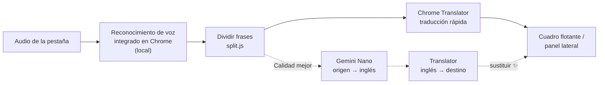

# 🎧 FreeLiveSub

**Subtítulos traducidos en tiempo real, gratis y 100 % en tu equipo: convierte el audio de cualquier pestaña en subtítulos bilingües «original + traducción».**

**Cuadro de subtítulos flotante**, **18 idiomas de origen × 39 de destino**, **modo Calidad mejor (Gemini Nano)**, **guardar frases dudosas**, **temas de estilo japonés** e interfaz en seis idiomas.

[](manifest.json)
[](#-requisitos)
[](#-privacidad)
[](LICENSE)
[](#-idiomas-de-la-interfaz)

[繁體中文](README.md) · [English](README.en.md) · [日本語](README.ja.md) · [简体中文](README.zh-Hans.md) · [한국어](README.ko.md) · **Español**

[Por qué](#-por-qué) · [Funciones](#-funciones) · [Cómo funciona](#-cómo-funciona) · [Instalación](#-instalación) · [Uso](#-uso) · [Requisitos](#-requisitos) · [Limitaciones conocidas](#-limitaciones-conocidas) · [Privacidad](#-privacidad) · [Desarrollo](#-desarrollo)

---

## 💡 Por qué

Veo muchos vídeos y directos en japonés e inglés, y dependo de los subtítulos en tiempo real. Pero casi todas las herramientas de traducción en vivo que encontré eran de pago, pedían una cuenta o enviaban el audio al servidor de otra persona. Así que hice la mía.

FreeLiveSub usa **solo el reconocimiento de voz y la traducción integrados en Chrome**, y todo funciona en tu equipo:

> [!NOTE]
> **Sin cuenta, sin clave de API, sin servidor y sin pagar.** El audio y el texto nunca salen de tu equipo.

## ✨ Funciones

- **Funciona en cualquier pestaña**: YouTube, niconico, directos, reuniones web… Si la pestaña tiene audio, pulsa el icono de la barra y empiezan los subtítulos.
- **Cuadro de subtítulos flotante**: arrástralo, cambia su tamaño desde cualquier esquina y sigue visible a pantalla completa. Desplázate hacia arriba para ver las últimas 50 líneas.
- **Muchos idiomas**: 18 idiomas de origen (japonés, inglés, chino, coreano, español, francés, alemán…) × 39 de destino. Lo que funciona depende de tu Chrome; el panel lateral marca cada uno como ✓ descargado / ⬇ descargable / ✕ no compatible.
- **División de frases largas**: el texto reconocido no tiene puntuación y suele juntar varias frases. FreeLiveSub las separa antes de traducir para no quedarse en la primera (con reglas específicas para el japonés).
- **Modo Calidad mejor ✨**: muestra primero la traducción rápida y luego vuelve a traducir las frases terminadas con Gemini Nano y las sustituye. Entiende mejor el lenguaje coloquial y el contexto.
- **Guardar frases dudosas ⭐**: compruébalas en Google Traductor o DeepL con un clic, cópialas como pregunta para una IA (con las frases anteriores) o vuelve a ese momento del vídeo. Exporta a Markdown.
- **Apariencia**: temas Cha (té) y Sumi (tinta) o tus propios colores, 12 colores tradicionales japoneses para el texto, color y tamaño independientes para el original y la traducción, o mostrar solo uno de los dos.
- **Idiomas de la interfaz**: 繁中 / English / 日本語 / 简中 / 한국어 / Español; por defecto sigue el idioma de Chrome.

## 🔊 Cómo funciona



| Paso | Usa | Se ejecuta en |
|---|---|---|
| Capturar el audio | `chrome.tabCapture` | Una página en segundo plano (offscreen document); cerrar el panel lateral no lo detiene |
| Reconocimiento de voz | Web Speech API `SpeechRecognition` (`processLocally`) | Local |
| Traducción | Translator API | Local |
| Calidad mejor | Prompt API (Gemini Nano) + Translator API | Local |

> [!TIP]
> Las pruebas mostraron que la traducción de Chrome «japonés → chino tradicional» en realidad pasa por el inglés. Por eso el modo Calidad mejor sigue la ruta «Gemini Nano traduce al inglés → Translator traduce al idioma de destino»: Nano se ocupa del paso más débil y el último paso siempre lo hace un modelo dedicado al idioma de destino, así que no se cuelan otros sistemas de escritura.

## 🚀 Instalación

FreeLiveSub todavía no está en Chrome Web Store. Instálalo con «Cargar descomprimida»:

| Paso | Cómo |
|---|---|
| 1. Descargar | Pulsa **[⬇ Descargar ZIP](https://github.com/Ashur5457/freelivesub/archive/refs/heads/main.zip)** y descomprímelo (obtendrás la carpeta `freelivesub-main`). Si usas git: `git clone https://github.com/Ashur5457/freelivesub.git` |
| 2. Activar el modo de desarrollador | Ve a `chrome://extensions` y activa «Modo de desarrollador» arriba a la derecha |
| 3. Cargar | Pulsa «Cargar descomprimida» y elige la carpeta `freelivesub-main` (la que contiene directamente `manifest.json`) |
| 4. Fijar el icono | Pulsa el botón de la pieza de puzle 🧩 en la barra y fija FreeLiveSub |
| 5. Preparar los modelos | Haz clic derecho en el icono de FreeLiveSub → «Abrir panel lateral», elige los idiomas y pulsa **Descargar modelos que faltan** (solo una vez) |

## 🎬 Uso

1. Abre una pestaña con audio y pulsa el **icono de FreeLiveSub** en la barra. Aparece el cuadro de subtítulos.
2. Pasa el cursor sobre el cuadro para ver la barra de herramientas: cambiar idiomas, tamaño del texto A−/A+, pausar, borrar, ⚙ ajustes, abrir el panel lateral, ✕ detener.
3. En ⚙ ajustes puedes cambiar el aspecto de los subtítulos, qué se muestra, la velocidad de actualización, la **calidad de la traducción** y el idioma de la interfaz.
4. Si una frase parece incorrecta, pulsa ⭐ a su derecha para guardarla y revisarla después en el panel lateral.

> [!NOTE]
> Después de cambiar de pestaña o recargar la página, vuelve a pulsar el icono en esa pestaña.

## 💻 Requisitos

| Elemento | Detalles |
|---|---|
| Navegador | Chrome de escritorio (desarrollado con Chrome 155 en Windows). Necesita el reconocimiento de voz local integrado y la Translator API, que las versiones antiguas pueden no tener |
| Modelos de voz | Unos 170–200 MB por idioma, se descargan la primera vez |
| Modelos de traducción | Decenas de MB por par de idiomas |
| Calidad mejor (opcional) | Gemini Nano necesita varios GB de espacio y suficiente memoria RAM o de GPU. Consulta la [documentación de Chrome](https://developer.chrome.com/docs/ai/prompt-api). Si tu equipo no cumple los requisitos, FreeLiveSub usa la traducción rápida |

Chrome descarga y gestiona los modelos y los comparte entre todos los sitios y extensiones. Desinstalar FreeLiveSub no los borra.

## ⚠️ Limitaciones conocidas

- **Los errores de reconocimiento no se pueden corregir**: por ejemplo, 美容院 (peluquería) se oye como 病院 (hospital). Todavía no hay glosario.
- **La traducción rápida no tiene contexto**: traduce frase a frase, así que las frases cortas y el lenguaje coloquial a menudo salen mal. Calidad mejor ayuda, pero tarda 1–3 s más por frase y usa más CPU.
- **Calidad mejor solo procesa frases de hasta 80 caracteres**: un modelo pequeño tiende a resumir los párrafos largos, así que esos mantienen la traducción rápida.
- **Las páginas propias de Chrome** (`chrome://…`) no pueden mostrar el cuadro flotante.
- **Modo panel lateral**: tras un rato de inactividad del script en segundo plano, el primer clic puede no abrir el panel lateral. Vuelve a pulsar.
- Probado sobre todo con japonés e inglés; los demás idiomas no se han probado a fondo.
- Las traducciones de la interfaz y del README, salvo el chino tradicional, las generó una IA. Se agradecen correcciones de hablantes nativos.

## 🔒 Privacidad

- El audio, el texto reconocido y las traducciones se procesan en tu equipo y **nunca se suben**.
- Los ajustes, la posición del cuadro y las frases guardadas se almacenan en el almacenamiento local de Chrome (`chrome.storage.local`).
- Los únicos enlaces a sitios externos son los botones «Google Traductor» y «DeepL» de las frases guardadas: la frase se envía a ese sitio **solo cuando pulsas**.
- Sin estadísticas, rastreo ni anuncios.

## 📂 Estructura

```
freelivesub/
├── manifest.json        # Manifiesto de la extensión (MV3)
├── sw.js                # Segundo plano: flujo al pulsar el icono, reenvío de mensajes
├── offscreen.html/.js   # Motor: captura de audio, reconocimiento, traducción, Calidad mejor
├── overlay.js           # Cuadro de subtítulos flotante (Shadow DOM), menú de ajustes
├── panel.html/.js       # Panel lateral: idiomas, estado de los modelos, historial, frases guardadas
├── prefs.js             # Ajustes compartidos, tabla de idiomas, temas, formulario de ajustes
├── split.js             # Limpieza de espacios, división de frases, unión de traducciones
├── marks.js             # Frases guardadas
├── i18n.js              # Textos de la interfaz (una línea por texto, seis idiomas en paralelo)
├── icons.js             # Iconos SVG en línea
├── lab.js               # Herramienta de desarrollo: comparar rutas de traducción con Gemini Nano
├── icons/               # Iconos de la extensión
├── tools/make_icons.ps1 # Genera los iconos (PowerShell)
└── CLAUDE.md            # Notas de desarrollo: arquitectura, problemas encontrados, progreso (chino tradicional)
```

## 🛠️ Desarrollo

Sin paso de compilación ni paquetes: después de editar, pulsa 🔄 recargar en `chrome://extensions`, recarga la pestaña del vídeo y vuelve a pulsar el icono.

Lee primero [`CLAUDE.md`](CLAUDE.md) (en chino tradicional). Tiene la arquitectura completa y los **problemas que ya hemos encontrado**. Algunas reglas:

1. **Todo en local**: no añadas nada que envíe audio o texto fuera (salvo los enlaces de comprobación que pulsa el usuario).
2. **Todos los textos de la interfaz van en `i18n.js`**: una línea por texto, seis idiomas en paralelo, sin columnas vacías.
3. **Usa `pointerdown` para los botones del área de subtítulos**: los subtítulos se redibujan varias veces por segundo y `click` no se dispara.
4. **Limita los estilos compartidos a tipos de elemento**: los estilos del formulario de ajustes comparten Shadow DOM con el cuadro flotante y los nombres de clase pueden chocar.

## 🌐 Idiomas de la interfaz

繁體中文, English, 日本語, 简体中文, 한국어, Español. Todo salvo el chino tradicional lo tradujo una IA. Si eres hablante nativo y ves algo poco natural, abre un issue o una pull request para `i18n.js` y el README correspondiente.

## 📄 Licencia

[MIT](LICENSE) © 2026 Ashur5457
