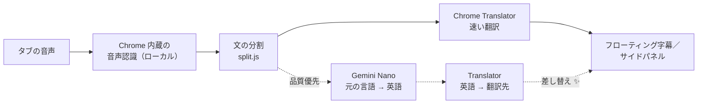

# 🎧 FreeLiveSub

**無料・完全にローカルで動くリアルタイム翻訳字幕：どのタブの音声も「原文＋訳文」の二か国語字幕に。**

**フローティング字幕**、**元の言語 18 × 翻訳先 39 言語**、**品質優先モード（Gemini Nano）**、**気になる字幕の保存**、**和風テーマ**、表示言語は 6 言語に対応。

[](manifest.json)
[](#-動作環境)
[](#-プライバシー)
[](LICENSE)
[](#-表示言語)

[繁體中文](README.md) · [English](README.en.md) · **日本語** · [简体中文](README.zh-Hans.md) · [한국어](README.ko.md) · [Español](README.es.md)

[なぜ作ったか](#-なぜ作ったか) · [できること](#-できること) · [しくみ](#-しくみ) · [インストール](#-インストール) · [使い方](#-使い方) · [動作環境](#-動作環境) · [既知の制限](#-既知の制限) · [プライバシー](#-プライバシー) · [類似プロジェクト](#-類似プロジェクト) · [開発](#-開発)

---

## 💡 なぜ作ったか

日本語や英語の動画・配信をよく見るので、リアルタイム字幕に頼っています。でも見つかるリアルタイム翻訳ツールは、ほとんどが有料か、アカウント登録が必要か、音声を他人のサーバーに送るものでした。だから自分で作りました。

FreeLiveSub は **Chrome に内蔵された音声認識と翻訳だけ**を使い、すべてあなたのパソコンの中で動きます。

> [!NOTE]
> **アカウントも API キーもサーバーも不要、料金もかかりません。**音声や文字がパソコンの外に出ることはありません。

## ✨ できること

- **どのタブでも使える**：YouTube、ニコニコ動画、配信、Web 会議…タブから音が出ていれば、ツールバーのアイコンを押すだけで字幕が始まります。
- **フローティング字幕**：ドラッグで移動、四隅で拡大縮小、全画面でも表示されます。上にスクロールすると直近 50 行を確認できます。
- **多言語**：元の言語 18（日本語、英語、中国語、韓国語、スペイン語、フランス語、ドイツ語…）× 翻訳先 39 言語。実際に使えるかは Chrome 次第で、サイドパネルに ✓ ダウンロード済み／⬇ ダウンロード可能／✕ 非対応 と表示されます。
- **長文の分割**：認識結果には句読点がなく、何文もつながりがちです。翻訳前に文を分けるので、最初の一文だけで翻訳が止まりません（日本語には専用のルールがあります）。
- **品質優先モード ✨**：まず速い翻訳を表示し、話し終えた文を Gemini Nano で訳し直して差し替えます。話し言葉や文脈に強くなります。
- **気になる字幕を保存 ⭐**：ワンクリックで Google 翻訳や DeepL で確認、前の文つきの AI 用の質問としてコピー、動画のその場面に戻って聞き直し。Markdown で書き出せます。
- **見た目**：茶・墨の和風テーマまたは好きな色、日本の伝統色 12 色の文字色、原文と訳文の色・サイズを別々に設定、片方だけの表示も可能。
- **表示言語**：繁中／English／日本語／简中／한국어／Español。既定では Chrome の言語に合わせます。

## 🔊 しくみ



| 処理 | 使うもの | 動く場所 |
|---|---|---|
| 音声の取得 | `chrome.tabCapture` | バックグラウンドページ（offscreen document）。サイドパネルを閉じても止まりません |
| 音声認識 | Web Speech API `SpeechRecognition`（`processLocally`） | ローカル |
| 翻訳 | Translator API | ローカル |
| 品質優先 | Prompt API（Gemini Nano）＋ Translator API | ローカル |

> [!TIP]
> 試してみると、Chrome の「日本語 → 繁体字中国語」翻訳は実は英語を経由していました。そこで品質優先モードは「Gemini Nano で英語に訳す → Translator で翻訳先の言語に訳す」という経路を取ります。いちばん弱い段階を Nano が受け持ち、最後の段階は必ず翻訳先の言語専用のモデルなので、簡体字や他の言語が混ざりません。

## 🚀 インストール

まだ Chrome ウェブストアには公開していません。「パッケージ化されていない拡張機能を読み込む」でインストールします。

| 手順 | やり方 |
|---|---|
| 1. ダウンロード | このページ上部の **Code → Download ZIP** を押して展開、または `git clone https://github.com/Ashur5457/freelivesub.git` |
| 2. デベロッパー モードをオン | アドレスバーに `chrome://extensions` と入力し、右上の「デベロッパー モード」をオン |
| 3. 読み込む | 「パッケージ化されていない拡張機能を読み込む」を押し、フォルダを選ぶ |
| 4. アイコンを固定 | ツールバーのパズルボタン 🧩 から FreeLiveSub のピンをオン |
| 5. モデルを準備 | FreeLiveSub アイコンを右クリック →「サイドパネルを開く」、言語を選んで **足りないモデルをダウンロード** を押す（1 回だけ） |

## 🎬 使い方

1. 音声が流れるタブで、ツールバーの **FreeLiveSub アイコン**を押すと字幕枠が表示されます。
2. 字幕枠にカーソルを合わせると上にツールバーが出ます：言語の切り替え、文字サイズ A−／A+、一時停止、消去、⚙ 設定、サイドパネル、✕ 停止。
3. ⚙ 設定では字幕の見た目、表示内容、更新速度、**翻訳の品質**、表示言語を変えられます。
4. おかしいと思った字幕は、右の ⭐ を押して保存し、あとでサイドパネルで確認できます。

> [!NOTE]
> タブを切り替えたりページを再読み込みしたりしたら、そのタブでもう一度アイコンを押してください。

## 💻 動作環境

| 項目 | 内容 |
|---|---|
| ブラウザ | デスクトップ版 Chrome（開発は Chrome 155、Windows）。Chrome 内蔵のローカル音声認識と Translator API が必要で、古いバージョンにはない場合があります |
| 音声モデル | 1 言語あたり約 170～200 MB、初回使用時にダウンロード |
| 翻訳モデル | 1 言語ペアあたり数十 MB |
| 品質優先（任意） | Gemini Nano には数 GB の空き容量と十分なメモリまたは GPU メモリが必要です。詳しくは [Chrome の公式ドキュメント](https://developer.chrome.com/docs/ai/prompt-api)。条件を満たさない場合は自動で速い翻訳を使います |

モデルは Chrome がまとめてダウンロード・管理し、すべてのサイトと拡張機能で共有します。FreeLiveSub を削除してもモデルは消えません。

## ⚠️ 既知の制限

- **認識の誤りは直せません**：たとえば「美容院」が「病院」と聞き取られることがあります。用語集はまだありません。
- **速い翻訳には文脈がありません**：1 文ずつ訳すので、短い文や話し言葉はよく間違えます。品質優先なら改善しますが、1 文あたり 1～3 秒遅く、CPU も多く使います。
- **品質優先は 80 文字までの文だけ**：小さいモデルは長い段落を要約してしまうため、長い文は速い翻訳のままにします。
- **Chrome 自身のページ**（`chrome://…`）にはフローティング字幕を表示できません。
- **サイドパネルモード**：バックグラウンドが一定時間アイドルになったあとの最初のクリックでは、サイドパネルが開かないことがあります。もう一度押してください。
- 主に日本語と英語でテストしています。ほかの言語は十分にテストしていません。
- 繁体字中国語以外の表示言語と README の翻訳は AI によるものです。ネイティブの方の修正を歓迎します。

## 🔒 プライバシー

- 音声、認識結果、翻訳はすべてパソコンの中で処理し、**アップロードしません**。
- 設定、字幕枠の位置、保存した字幕は Chrome のローカルストレージ（`chrome.storage.local`）に保存します。
- 外部サイトにつながるのは、保存した字幕の「Google 翻訳」「DeepL」ボタンだけです。**押したときだけ**、その一文がそのサイトに送られます。
- 統計・トラッキング・広告は一切ありません。

## 🧭 類似プロジェクト

| プロジェクト | 方式 | 違い |
|---|---|---|
| [live-captions-translate](https://github.com/petercunha/live-captions-translate) | Moonshine／Whisper（WebGPU）で認識＋Chrome Translator、ローカル | 認識モデルを別途ダウンロードし GPU を使う。FreeLiveSub は Chrome 内蔵の認識を使用 |
| [x-jimaku](https://github.com/Sora-bluesky/x-jimaku) | Whisper で認識＋Gemini Nano／Translator | x.com の動画のみ、英語 → 日本語 |
| [subtitle_autopilot_ext](https://github.com/j75689/subtitle_autopilot_ext) | Translator で下訳＋Gemini Nano で仕上げ | 動画にもともとある字幕を翻訳し、音声は扱わない |
| [subtrans-ai-lab](https://github.com/KOJH-archive/subtrans-ai-lab) | Gemini Nano＋Translator＋ローカル認識 | 実験的なプロトタイプ |

## 📂 ファイル構成

```
freelivesub/
├── manifest.json        # 拡張機能の設定（MV3）
├── sw.js                # バックグラウンド：アイコンを押したときの流れ、メッセージの中継
├── offscreen.html/.js   # エンジン：音声取得、認識、翻訳、品質優先
├── overlay.js           # フローティング字幕（Shadow DOM）、設定メニュー
├── panel.html/.js       # サイドパネル：言語、モデルの状態、字幕の履歴、保存した字幕
├── prefs.js             # 共通設定、言語表、テーマ、設定フォーム
├── split.js             # 空白の削除、文の分割、訳文の結合
├── marks.js             # 保存した字幕
├── i18n.js              # 表示テキスト（1 行に 1 文、6 言語を並べて記述）
├── icons.js             # インライン SVG アイコン
├── lab.js               # 開発用：Gemini Nano の翻訳経路の比較
├── icons/               # 拡張機能のアイコン
├── tools/make_icons.ps1 # アイコン生成（PowerShell）
└── CLAUDE.md            # 開発メモ：構成、ハマりどころ、進捗（繁体字中国語）
```

## 🛠️ 開発

ビルドもパッケージのインストールも不要です。編集したら `chrome://extensions` で 🔄 再読み込みし、動画のタブを再読み込みしてもう一度アイコンを押します。

先に [`CLAUDE.md`](CLAUDE.md)（繁体字中国語）を読んでください。構成と**これまでのハマりどころ**がまとまっています。主なルール：

1. **ローカルで完結**：音声や文字を外部に送る機能は追加しない（ユーザーが押す確認用リンクを除く）。
2. **表示テキストはすべて `i18n.js` に**：1 行に 1 文、6 言語を並べ、抜けをなくす。
3. **字幕エリアのボタンは `pointerdown` を使う**：字幕は 1 秒に何度も描き直されるため、`click` が発火しない。
4. **共通スタイルは要素の種類まで指定する**：設定フォームのスタイルはフローティング字幕と同じ Shadow DOM にあり、クラス名がぶつかりやすい。

## 🌐 表示言語

繁體中文、English、日本語、简体中文、한국어、Español。繁体字中国語以外は AI による翻訳です。ネイティブの方で不自然な表現に気づいたら、`i18n.js` と対応する README について Issue か Pull Request をお願いします。

## 📄 ライセンス

[MIT](LICENSE) © 2026 Ashur5457
