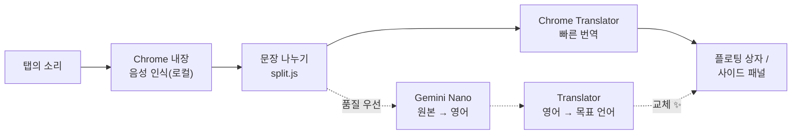

# 🎧 FreeLiveSub

**무료로, 내 컴퓨터 안에서만 동작하는 실시간 번역 자막: 어떤 탭의 소리든 "원문 + 번역" 이중 자막으로.**

**플로팅 자막 상자**, **원본 18개 × 번역 39개 언어**, **품질 우선 모드(Gemini Nano)**, **의심스러운 문장 저장**, **일본 전통 스타일 테마**, 6개 인터페이스 언어 지원.

[](manifest.json)
[](#-요구-사항)
[](#-개인정보)
[](LICENSE)
[](#-인터페이스-언어)

[繁體中文](README.md) · [English](README.en.md) · [日本語](README.ja.md) · [简体中文](README.zh-Hans.md) · **한국어** · [Español](README.es.md)

[만든 이유](#-만든-이유) · [기능](#-기능) · [작동 방식](#-작동-방식) · [설치](#-설치) · [사용법](#-사용법) · [요구 사항](#-요구-사항) · [알려진 제한](#-알려진-제한) · [개인정보](#-개인정보) · [개발](#-개발)

---

## 💡 만든 이유

일본어와 영어 영상, 라이브 방송을 자주 봐서 실시간 자막에 많이 의존합니다. 그런데 찾아본 실시간 번역 도구는 거의 다 유료이거나, 회원 가입이 필요하거나, 소리를 다른 사람의 서버로 보냈습니다. 그래서 직접 만들었습니다.

FreeLiveSub는 **Chrome에 내장된 음성 인식과 번역 기능만** 사용하며, 모든 처리가 내 컴퓨터에서 이루어집니다.

> [!NOTE]
> **계정, API 키, 서버가 필요 없고 비용도 들지 않습니다.** 소리와 글자는 컴퓨터 밖으로 나가지 않습니다.

## ✨ 기능

- **어떤 탭에서든 사용**: YouTube, 니코니코, 라이브 방송, 웹 회의… 탭에서 소리가 나면 툴바 아이콘을 누르기만 하면 자막이 시작됩니다.
- **플로팅 자막 상자**: 끌어서 옮기고, 네 모서리로 크기를 바꿀 수 있으며, 전체 화면에서도 보입니다. 위로 스크롤하면 최근 50줄을 볼 수 있습니다.
- **다국어**: 원본 18개 언어(일본어, 영어, 중국어, 한국어, 스페인어, 프랑스어, 독일어…) × 번역 39개 언어. 실제로 쓸 수 있는지는 Chrome에 따라 다르며, 사이드 패널에 ✓ 다운로드됨 / ⬇ 다운로드 가능 / ✕ 지원 안 됨으로 표시됩니다.
- **긴 문장 나누기**: 인식 결과에는 문장 부호가 없어 여러 문장이 이어지기 쉽습니다. 번역 전에 문장을 나누므로 첫 문장만 번역되고 끝나지 않습니다(일본어 전용 규칙 포함).
- **품질 우선 모드 ✨**: 먼저 빠른 번역을 보여 주고, 끝난 문장을 Gemini Nano로 다시 번역해 바꿉니다. 구어체와 문맥을 더 잘 이해합니다.
- **의심스러운 문장 저장 ⭐**: 클릭 한 번으로 Google 번역이나 DeepL에서 확인하고, 앞 문장과 함께 AI 질문으로 복사하거나, 영상의 그 장면으로 돌아가 다시 들을 수 있습니다. Markdown으로 내보낼 수 있습니다.
- **모양**: 차(茶)·먹(墨) 두 가지 일본 전통 스타일 테마 또는 직접 고른 색, 일본 전통색 12가지 글자 색, 원문과 번역의 색·크기 따로 설정, 한쪽만 표시.
- **인터페이스 언어**: 繁中 / English / 日本語 / 简中 / 한국어 / Español. 기본값은 Chrome의 언어를 따릅니다.

## 🔊 작동 방식



| 단계 | 사용하는 것 | 실행 위치 |
|---|---|---|
| 소리 가져오기 | `chrome.tabCapture` | 백그라운드 페이지(offscreen document). 사이드 패널을 닫아도 멈추지 않음 |
| 음성 인식 | Web Speech API `SpeechRecognition`(`processLocally`) | 로컬 |
| 번역 | Translator API | 로컬 |
| 품질 우선 | Prompt API(Gemini Nano) + Translator API | 로컬 |

> [!TIP]
> 테스트해 보니 Chrome의 "일본어 → 번체 중국어" 번역은 사실 영어를 거쳐 갑니다. 그래서 품질 우선 모드는 "Gemini Nano가 영어로 번역 → Translator가 목표 언어로 번역" 경로를 사용합니다. 가장 약한 단계를 Nano가 맡고, 마지막 단계는 항상 목표 언어 전용 모델이라 다른 문자가 섞이지 않습니다.

## 🚀 설치

아직 Chrome 웹 스토어에 올리지 않았습니다. "압축해제된 확장 프로그램을 로드합니다"로 설치하세요.

| 단계 | 방법 |
|---|---|
| 1. 다운로드 | **[⬇ ZIP 다운로드](https://github.com/Ashur5457/freelivesub/archive/refs/heads/main.zip)**를 눌러 압축을 풉니다(`freelivesub-main` 폴더가 생깁니다). git을 쓴다면 `git clone https://github.com/Ashur5457/freelivesub.git` |
| 2. 개발자 모드 켜기 | 주소창에 `chrome://extensions`를 입력하고 오른쪽 위 "개발자 모드"를 켭니다 |
| 3. 로드 | "압축해제된 확장 프로그램을 로드합니다"를 눌러 `freelivesub-main` 폴더(안에 `manifest.json`이 바로 보이는 폴더)를 선택합니다 |
| 4. 아이콘 고정 | 툴바의 퍼즐 버튼 🧩에서 FreeLiveSub 옆의 핀을 켭니다 |
| 5. 모델 준비 | FreeLiveSub 아이콘을 오른쪽 클릭 → "사이드 패널 열기", 언어를 고른 뒤 **빠진 모델 다운로드**를 누릅니다(한 번만) |

## 🎬 사용법

1. 소리가 나는 탭에서 툴바의 **FreeLiveSub 아이콘**을 누르면 자막 상자가 나타납니다.
2. 자막 상자에 마우스를 올리면 위쪽에 툴바가 나타납니다: 언어 전환, 글자 크기 A−/A+, 일시정지, 지우기, ⚙ 설정, 사이드 패널, ✕ 중지.
3. ⚙ 설정에서 자막 모양, 표시 내용, 업데이트 속도, **번역 품질**, 인터페이스 언어를 바꿀 수 있습니다.
4. 번역이 이상한 문장은 오른쪽의 ⭐을 눌러 저장하고, 나중에 사이드 패널에서 확인하세요.

> [!NOTE]
> 탭을 바꾸거나 페이지를 새로 고친 뒤에는 그 탭에서 아이콘을 다시 눌러야 합니다.

## 💻 요구 사항

| 항목 | 설명 |
|---|---|
| 브라우저 | 데스크톱 Chrome(개발 환경은 Chrome 155, Windows). Chrome 내장 로컬 음성 인식과 Translator API가 필요하며, 이전 버전에는 없을 수 있습니다 |
| 음성 모델 | 언어당 약 170~200 MB, 처음 사용할 때 다운로드 |
| 번역 모델 | 언어 쌍당 수십 MB |
| 품질 우선(선택) | Gemini Nano에는 수 GB의 저장 공간과 충분한 메모리 또는 GPU 메모리가 필요합니다. 자세한 내용은 [Chrome 공식 문서](https://developer.chrome.com/docs/ai/prompt-api)를 참고하세요. 조건이 맞지 않으면 자동으로 빠른 번역을 사용합니다 |

모델은 Chrome이 한꺼번에 다운로드하고 관리하며, 모든 사이트와 확장 프로그램이 함께 씁니다. FreeLiveSub를 삭제해도 모델은 지워지지 않습니다.

## ⚠️ 알려진 제한

- **인식 오류는 고칠 수 없습니다**: 예를 들어 美容院(미용실)을 病院(병원)으로 잘못 듣는 경우가 있습니다. 아직 용어집은 없습니다.
- **빠른 번역에는 문맥이 없습니다**: 한 문장씩 번역하므로 짧은 문장과 구어체는 자주 틀립니다. 품질 우선이 낫지만 문장마다 1~3초 더 걸리고 CPU를 더 씁니다.
- **품질 우선은 80자 이하 문장만 처리합니다**: 작은 모델은 긴 단락을 요약해 버리므로 긴 문장은 빠른 번역을 유지합니다.
- **Chrome 자체 페이지**(`chrome://…`)에는 플로팅 상자를 표시할 수 없습니다.
- **사이드 패널 모드**: 백그라운드가 한동안 쉬고 난 뒤 첫 클릭에서는 사이드 패널이 열리지 않을 수 있습니다. 한 번 더 누르세요.
- 주로 일본어와 영어로 테스트했으며, 다른 언어는 충분히 테스트하지 않았습니다.
- 번체 중국어 이외의 인터페이스와 README 번역은 AI가 만들었습니다. 원어민의 수정을 환영합니다.

## 🔒 개인정보

- 소리, 인식 결과, 번역은 모두 내 컴퓨터에서 처리하며 **업로드하지 않습니다**.
- 설정, 자막 상자 위치, 저장한 문장은 Chrome 로컬 저장소(`chrome.storage.local`)에 저장됩니다.
- 외부 사이트로 연결되는 것은 저장한 문장의 "Google 번역", "DeepL" 버튼뿐이며, **직접 누를 때만** 그 문장이 해당 사이트로 전송됩니다.
- 통계, 추적, 광고가 전혀 없습니다.

## 📂 파일 구조

```
freelivesub/
├── manifest.json        # 확장 프로그램 설정(MV3)
├── sw.js                # 백그라운드: 아이콘 클릭 흐름, 메시지 전달
├── offscreen.html/.js   # 엔진: 소리 가져오기, 인식, 번역, 품질 우선
├── overlay.js           # 플로팅 자막 상자(Shadow DOM), 설정 메뉴
├── panel.html/.js       # 사이드 패널: 언어, 모델 상태, 자막 기록, 저장한 문장
├── prefs.js             # 공통 설정, 언어 표, 테마, 설정 양식
├── split.js             # 공백 정리, 문장 나누기, 번역 이어 붙이기
├── marks.js             # 저장한 문장
├── i18n.js              # 인터페이스 문구(한 줄에 한 문장, 6개 언어를 나란히)
├── icons.js             # 인라인 SVG 아이콘
├── lab.js               # 개발용: Gemini Nano 번역 경로 비교
├── icons/               # 확장 프로그램 아이콘
├── tools/make_icons.ps1 # 아이콘 생성(PowerShell)
└── CLAUDE.md            # 개발 문서: 구조, 겪었던 문제, 진행 상황(번체 중국어)
```

## 🛠️ 개발

빌드 도구도, 패키지 설치도 필요 없습니다. 파일을 고친 뒤 `chrome://extensions`에서 🔄 새로 고침을 누르고, 영상 탭을 새로 고친 다음 아이콘을 다시 누르세요.

먼저 [`CLAUDE.md`](CLAUDE.md)(번체 중국어)를 읽어 주세요. 전체 구조와 **겪었던 문제들**이 정리되어 있습니다. 주요 규칙:

1. **로컬에서만 처리**: 소리나 글자를 외부로 보내는 기능은 추가하지 않습니다(사용자가 직접 누르는 확인용 링크 제외).
2. **인터페이스 문구는 모두 `i18n.js`에**: 한 줄에 한 문장, 6개 언어를 나란히 쓰고 빠진 칸이 없어야 합니다.
3. **자막 영역의 버튼은 `pointerdown` 사용**: 자막이 1초에 여러 번 다시 그려져 `click`이 동작하지 않습니다.
4. **공통 스타일은 요소 종류까지 지정**: 설정 양식의 스타일이 플로팅 상자와 같은 Shadow DOM에 있어 클래스 이름이 겹치기 쉽습니다.

## 🌐 인터페이스 언어

繁體中文, English, 日本語, 简体中文, 한국어, Español. 번체 중국어 이외는 AI가 번역했습니다. 원어민으로서 어색한 표현을 발견하면 `i18n.js`와 해당 README에 대해 Issue나 Pull Request를 보내 주세요.

## 📄 라이선스

[MIT](LICENSE) © 2026 Ashur5457
