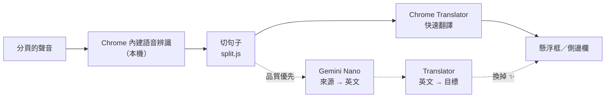

# 🎧 FreeLiveSub

**免費、完全在本機運作的即時翻譯字幕：任何分頁的聲音，都能變成「原文＋譯文」雙語字幕。**

**懸浮字幕框**、**18 種來源語言 × 39 種翻譯語言**、**品質優先模式（Gemini Nano）**、**收藏有疑義的句子**、**和風主題**，介面支援六種語言。

[](manifest.json)
[](#-需求)
[](#-隱私)
[](LICENSE)
[](#-介面語言)

**繁體中文** · [English](README.en.md) · [日本語](README.ja.md) · [简体中文](README.zh-Hans.md) · [한국어](README.ko.md) · [Español](README.es.md)

[為什麼做](#-為什麼做) · [能做什麼](#-能做什麼) · [怎麼運作](#-怎麼運作) · [安裝](#-安裝) · [使用](#-使用) · [需求](#-需求) · [已知限制](#-已知限制) · [隱私](#-隱私) · [類似專案](#-類似專案) · [開發](#-開發)

---

## 💡 為什麼做

我常常需要看日文、英文的影片和直播，很依賴即時字幕。但找到的即時翻譯工具幾乎都要付費、要註冊帳號，或是要把聲音傳到別人的伺服器。所以我自己做了一個。

FreeLiveSub 只用 **Chrome 內建的語音辨識和翻譯功能**，全部在你的電腦上運作：

> [!NOTE]
> **不需要帳號、不需要 API 金鑰、不需要架伺服器，也不用付費。**聲音和文字都不會離開你的電腦。

## ✨ 能做什麼

- **任何分頁都能用**：YouTube、niconico、直播、線上會議網頁版…只要分頁有聲音，點一下工具列圖示就開始出字幕。
- **懸浮字幕框**：可拖曳、四個角都能縮放，全螢幕時也看得到。可以往上捲看最近 50 句。
- **多語言**：18 種來源語言（日、英、中、韓、西、法、德…）× 39 種翻譯語言，實際能用哪些由你的 Chrome 決定，側邊欄會標示 ✓ 已下載／⬇ 可下載／✕ 不支援。
- **長句切段**：辨識結果沒有標點、好幾句黏在一起時，先切開再翻譯，不會只翻第一句（日文有專門的切句規則）。
- **品質優先模式 ✨**：先顯示快速翻譯，講完的句子再用 Gemini Nano 重翻並換掉，比較懂口語和上下文。
- **收藏有疑義的句子 ⭐**：一鍵用 Google 翻譯／DeepL 查證、複製成 AI 提問（附前文），或回到影片當下的時間點重聽。可匯出成 Markdown。
- **外觀**：茶／墨兩種和風主題或自訂顏色、12 種日本傳統色字色、原文和譯文的顏色大小分開設定、只顯示譯文或原文。
- **介面語言**：繁中／English／日本語／简中／한국어／Español，預設跟著 Chrome 的語言。

## 🔊 怎麼運作



| 環節 | 用的是 | 在哪裡跑 |
|---|---|---|
| 擷取聲音 | `chrome.tabCapture` | 背景頁面（offscreen document），關掉側邊欄也不影響 |
| 語音辨識 | Web Speech API `SpeechRecognition`（`processLocally`） | 本機 |
| 翻譯 | Translator API | 本機 |
| 品質優先 | Prompt API（Gemini Nano）＋ Translator API | 本機 |

> [!TIP]
> 實測發現 Chrome 的「日文 → 繁中」翻譯其實是經過英文中轉，所以品質優先模式改走「Gemini Nano 翻成英文 → Translator 翻成目標語言」：讓 Nano 負責最弱的那一步，最後一步一定是目標語言的專用模型，不會冒出簡體字或其他語言。

## 🚀 安裝

目前還沒上架 Chrome 線上應用程式商店，請用「載入未封裝項目」安裝：

| 步驟 | 做法 |
|---|---|
| 1. 下載 | 按這頁上方的 **Code → Download ZIP**，解壓縮；或 `git clone https://github.com/Ashur5457/freelivesub.git` |
| 2. 開啟開發人員模式 | Chrome 網址列輸入 `chrome://extensions`，打開右上角的「開發人員模式」 |
| 3. 載入 | 按「載入未封裝項目」，選剛才的資料夾 |
| 4. 釘選圖示 | 按工具列的拼圖按鈕 🧩，把 FreeLiveSub 旁邊的圖釘點亮 |
| 5. 準備模型 | 在 FreeLiveSub 圖示上按右鍵 →「開啟側邊面板」，選好語言後按「**下載缺少的模型**」（只需一次） |

## 🎬 使用

1. 打開一個有聲音的分頁，點工具列的 **FreeLiveSub 圖示**，字幕框就會出現。
2. 滑鼠移到字幕框上，上方會出現工具列：切換語言、字級 A−／A+、暫停、清除、⚙ 設定、開側邊欄、✕ 停止。
3. ⚙ 設定裡可以調整字幕外觀、顯示內容、更新速度、**翻譯品質**和介面語言。
4. 覺得翻得怪的句子，按右邊的 ⭐ 收藏，之後在側邊欄查證。

> [!NOTE]
> 換分頁或重新整理網頁後，要在那個分頁再點一次圖示。

## 💻 需求

| 項目 | 說明 |
|---|---|
| 瀏覽器 | 桌面版 Chrome（開發時用 Chrome 155，Windows）。需要內建的本機語音辨識和 Translator API，舊版 Chrome 可能沒有 |
| 語音模型 | 每種語言約 170～200 MB，第一次使用時下載 |
| 翻譯模型 | 每組語言數十 MB |
| 品質優先（選用） | Gemini Nano 需要數 GB 空間，以及足夠的記憶體或顯示卡記憶體，詳見 [Chrome 官方說明](https://developer.chrome.com/docs/ai/prompt-api)。電腦不符合時會自動改用快速翻譯 |

模型由 Chrome 統一下載和管理，所有網站和擴充功能共用；移除 FreeLiveSub 不會刪掉模型。

## ⚠️ 已知限制

- **辨識錯字無法修正**：例如美容院被聽成病院。目前沒有術語表。
- **翻譯沒有上下文**：快速模式一句一句翻，短句和口語容易翻錯；品質優先比較好，但每句慢 1～3 秒、比較吃 CPU。
- **品質優先只處理 80 字以內的句子**：長段落交給小模型會被濃縮，所以保留快速翻譯。
- **Chrome 自己的頁面**（`chrome://…`）不能顯示懸浮框。
- **側邊欄模式**：背景程式閒置一段時間後，第一次點圖示可能不會自動打開側邊欄，再點一次即可。
- 主要用日文、英文測試，其他語言還沒充分測試。
- 繁中以外的介面和 README 翻譯由 AI 產生，歡迎母語者修正。

## 🔒 隱私

- 聲音、辨識結果、翻譯都在你的電腦上處理，**不會上傳**。
- 設定、字幕框位置、收藏的句子都存在 Chrome 的本機儲存空間（`chrome.storage.local`）。
- 唯一會連到外部網站的是收藏卡片上的「Google 翻譯」「DeepL」按鈕：**只有你按下時**，才會把那一句話送到該網站。
- 沒有任何統計、追蹤或廣告。

## 🧭 類似專案

| 專案 | 做法 | 差別 |
|---|---|---|
| [live-captions-translate](https://github.com/petercunha/live-captions-translate) | Moonshine／Whisper（WebGPU）辨識＋Chrome Translator，本機 | 辨識模型要另外下載、靠顯示卡；FreeLiveSub 用 Chrome 內建辨識 |
| [x-jimaku](https://github.com/Sora-bluesky/x-jimaku) | Whisper 辨識＋Gemini Nano／Translator | 只支援 x.com 影片、英文 → 日文 |
| [subtitle_autopilot_ext](https://github.com/j75689/subtitle_autopilot_ext) | Translator 初稿＋Gemini Nano 潤飾 | 翻譯影片本來就有的字幕，不處理聲音 |
| [subtrans-ai-lab](https://github.com/KOJH-archive/subtrans-ai-lab) | Gemini Nano＋Translator＋本機辨識 | 實驗性原型 |

## 📂 檔案結構

```
freelivesub/
├── manifest.json        # 擴充功能設定（MV3）
├── sw.js                # 背景程式：點圖示流程、轉送訊息
├── offscreen.html/.js   # 背景引擎：擷取聲音、辨識、翻譯、品質優先
├── overlay.js           # 懸浮字幕框（Shadow DOM）、設定選單
├── panel.html/.js       # 側邊欄：語言、模型狀態、字幕紀錄、收藏
├── prefs.js             # 共用設定、語言表、主題、設定表單
├── split.js             # 刪空格、切句子、接回譯文
├── marks.js             # 收藏的句子
├── i18n.js              # 介面文字（每句一行，六種語言並排）
├── icons.js             # 內嵌 SVG 圖示
├── lab.js               # 開發用：Gemini Nano 翻譯路線比較
├── icons/               # 擴充功能圖示
├── tools/make_icons.ps1 # 產生圖示（PowerShell）
└── CLAUDE.md            # 開發文件：架構、踩過的坑、進度
```

## 🛠️ 開發

不需要建置工具，也不需要安裝套件：改完檔案後在 `chrome://extensions` 按 🔄 重新載入，再重新整理影片分頁、點一次圖示。

開發前先讀 [`CLAUDE.md`](CLAUDE.md)，裡面有完整的架構說明和**踩過的坑**。幾條規則：

1. **完全在本機**：不加任何把聲音或文字送到外部的功能（使用者自己按的查證連結除外）。
2. **介面文字一律放 `i18n.js`**：每一句一行、六種語言並排，不能漏欄。
3. **字幕區的按鈕用 `pointerdown`**：字幕每秒重畫好幾次，`click` 會失效。
4. **共用樣式要限定元素類型**：設定表單的樣式和懸浮框放在同一個 Shadow DOM，類別名稱容易撞到。

## 🌐 介面語言

繁體中文、English、日本語、简体中文、한국어、Español。繁中以外的翻譯由 AI 產生，如果你是母語者、發現不自然的地方，歡迎開 Issue 或 Pull Request 修正 `i18n.js` 和對應的 README。

## 📄 授權

[MIT](LICENSE) © 2026 Ashur5457
