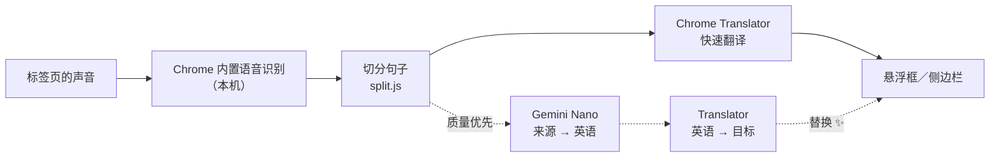

# 🎧 FreeLiveSub

**免费、完全在本机运行的实时翻译字幕：任何标签页的声音，都能变成“原文＋译文”双语字幕。**

**悬浮字幕框**、**18 种来源语言 × 39 种翻译语言**、**质量优先模式（Gemini Nano）**、**收藏有疑问的句子**、**和风主题**，界面支持六种语言。

[](manifest.json)
[](#-需求)
[](#-隐私)
[](LICENSE)
[](#-界面语言)

[繁體中文](README.md) · [English](README.en.md) · [日本語](README.ja.md) · **简体中文** · [한국어](README.ko.md) · [Español](README.es.md)

[为什么做](#-为什么做) · [能做什么](#-能做什么) · [怎么运作](#-怎么运作) · [安装](#-安装) · [使用](#-使用) · [需求](#-需求) · [已知限制](#-已知限制) · [隐私](#-隐私) · [开发](#-开发)

---

## 💡 为什么做

我经常看日语、英语的视频和直播，很依赖实时字幕。但找到的实时翻译工具几乎都要付费、要注册账号，或是要把声音传到别人的服务器。所以我自己做了一个。

FreeLiveSub 只用 **Chrome 内置的语音识别和翻译功能**，全部在你的电脑上运行：

> [!NOTE]
> **不需要账号、不需要 API 密钥、不需要搭服务器，也不用付费。**声音和文字都不会离开你的电脑。

## ✨ 能做什么

- **任何标签页都能用**：YouTube、niconico、直播、网页版在线会议……只要标签页有声音，点一下工具栏图标就开始出字幕。
- **悬浮字幕框**：可拖动、四个角都能缩放，全屏时也看得到。可以往上滚动查看最近 50 句。
- **多语言**：18 种来源语言（日、英、中、韩、西、法、德……）× 39 种翻译语言，实际能用哪些由你的 Chrome 决定，侧边栏会标出 ✓ 已下载／⬇ 可下载／✕ 不支持。
- **长句切分**：识别结果没有标点、好几句连在一起时，先切开再翻译，不会只翻第一句（日语有专门的切句规则）。
- **质量优先模式 ✨**：先显示快速翻译，说完的句子再用 Gemini Nano 重新翻译并替换，更懂口语和上下文。
- **收藏有疑问的句子 ⭐**：一键用 Google 翻译／DeepL 查证、复制成 AI 提问（附前文），或回到视频当时的时间点重听。可导出为 Markdown。
- **外观**：茶／墨两种和风主题或自定义颜色、12 种日本传统色字色、原文和译文的颜色大小分开设置、只显示译文或原文。
- **界面语言**：繁中／English／日本語／简中／한국어／Español，默认跟随 Chrome 的语言。

## 🔊 怎么运作



| 环节 | 用的是 | 在哪里运行 |
|---|---|---|
| 获取声音 | `chrome.tabCapture` | 后台页面（offscreen document），关掉侧边栏也不影响 |
| 语音识别 | Web Speech API `SpeechRecognition`（`processLocally`） | 本机 |
| 翻译 | Translator API | 本机 |
| 质量优先 | Prompt API（Gemini Nano）＋ Translator API | 本机 |

> [!TIP]
> 实测发现 Chrome 的“日语 → 繁体中文”翻译其实是经过英语中转，所以质量优先模式改走“Gemini Nano 翻成英语 → Translator 翻成目标语言”：让 Nano 负责最弱的那一步，最后一步一定是目标语言的专用模型，不会混进其他文字。

## 🚀 安装

目前还没有上架 Chrome 应用商店，请用“加载已解压的扩展程序”安装：

| 步骤 | 做法 |
|---|---|
| 1. 下载 | 点 **[⬇ 下载 ZIP](https://github.com/Ashur5457/freelivesub/archive/refs/heads/main.zip)**，下载后解压（会得到 `freelivesub-main` 文件夹）。会用 git 的话也可以 `git clone https://github.com/Ashur5457/freelivesub.git` |
| 2. 打开开发者模式 | 在地址栏输入 `chrome://extensions`，打开右上角的“开发者模式” |
| 3. 加载 | 点“加载已解压的扩展程序”，选择 `freelivesub-main` 文件夹（里面要直接看到 `manifest.json`） |
| 4. 固定图标 | 点工具栏的拼图按钮 🧩，把 FreeLiveSub 旁边的图钉点亮 |
| 5. 准备模型 | 在 FreeLiveSub 图标上点右键 →“打开侧边栏”，选好语言后点 **下载缺少的模型**（只需一次） |

## 🎬 使用

1. 打开一个有声音的标签页，点工具栏的 **FreeLiveSub 图标**，字幕框就会出现。
2. 鼠标移到字幕框上，上方会出现工具栏：切换语言、字号 A−／A+、暂停、清除、⚙ 设置、打开侧边栏、✕ 停止。
3. ⚙ 设置里可以调整字幕外观、显示内容、更新速度、**翻译质量**和界面语言。
4. 觉得翻得奇怪的句子，点右边的 ⭐ 收藏，之后在侧边栏查证。

> [!NOTE]
> 切换标签页或刷新网页后，要在那个标签页再点一次图标。

## 💻 需求

| 项目 | 说明 |
|---|---|
| 浏览器 | 桌面版 Chrome（开发时使用 Chrome 155，Windows）。需要内置的本机语音识别和 Translator API，旧版 Chrome 可能没有 |
| 语音模型 | 每种语言约 170～200 MB，第一次使用时下载 |
| 翻译模型 | 每组语言几十 MB |
| 质量优先（可选） | Gemini Nano 需要几 GB 空间，以及足够的内存或显存，详见 [Chrome 官方说明](https://developer.chrome.com/docs/ai/prompt-api)。电脑不符合条件时会自动改用快速翻译 |

模型由 Chrome 统一下载和管理，所有网站和扩展程序共用；移除 FreeLiveSub 不会删除模型。

## ⚠️ 已知限制

- **识别错误无法修正**：例如“美容院”被听成“病院”（医院）。目前没有术语表。
- **快速翻译没有上下文**：一句一句翻，短句和口语容易翻错；质量优先会好一些，但每句慢 1～3 秒、更占 CPU。
- **质量优先只处理 80 字以内的句子**：长段落交给小模型会被压缩，所以保留快速翻译。
- **Chrome 自己的页面**（`chrome://…`）不能显示悬浮框。
- **侧边栏模式**：后台程序闲置一段时间后，第一次点图标可能不会自动打开侧边栏，再点一次即可。
- 主要用日语、英语测试，其他语言还没有充分测试。
- 繁体中文以外的界面和 README 翻译由 AI 生成，欢迎母语者修正。

## 🔒 隐私

- 声音、识别结果、翻译都在你的电脑上处理，**不会上传**。
- 设置、字幕框位置、收藏的句子都保存在 Chrome 的本地存储（`chrome.storage.local`）。
- 唯一会连到外部网站的是收藏卡片上的“Google 翻译”“DeepL”按钮：**只有你点击时**，才会把那一句话发送到该网站。
- 没有任何统计、追踪或广告。

## 📂 文件结构

```
freelivesub/
├── manifest.json        # 扩展程序配置（MV3）
├── sw.js                # 后台程序：点图标流程、转发消息
├── offscreen.html/.js   # 后台引擎：获取声音、识别、翻译、质量优先
├── overlay.js           # 悬浮字幕框（Shadow DOM）、设置菜单
├── panel.html/.js       # 侧边栏：语言、模型状态、字幕记录、收藏
├── prefs.js             # 共用设置、语言表、主题、设置表单
├── split.js             # 删除空格、切分句子、拼接译文
├── marks.js             # 收藏的句子
├── i18n.js              # 界面文字（每句一行，六种语言并排）
├── icons.js             # 内嵌 SVG 图标
├── lab.js               # 开发用：比较 Gemini Nano 翻译路线
├── icons/               # 扩展程序图标
├── tools/make_icons.ps1 # 生成图标（PowerShell）
└── CLAUDE.md            # 开发文档：架构、踩过的坑、进度（繁体中文）
```

## 🛠️ 开发

不需要构建工具，也不需要安装依赖：改完文件后在 `chrome://extensions` 点 🔄 重新加载，再刷新视频标签页、点一次图标。

开发前先读 [`CLAUDE.md`](CLAUDE.md)（繁体中文），里面有完整的架构说明和**踩过的坑**。几条规则：

1. **完全在本机**：不加任何把声音或文字发到外部的功能（用户自己点的查证链接除外）。
2. **界面文字一律放在 `i18n.js`**：每句一行、六种语言并排，不能漏栏。
3. **字幕区的按钮用 `pointerdown`**：字幕每秒重绘好几次，`click` 会失效。
4. **共用样式要限定元素类型**：设置表单的样式和悬浮框在同一个 Shadow DOM 里，类名容易冲突。

## 🌐 界面语言

繁體中文、English、日本語、简体中文、한국어、Español。繁体中文以外的翻译由 AI 生成，如果你是母语者、发现不自然的地方，欢迎提交 Issue 或 Pull Request 修正 `i18n.js` 和对应的 README。

## 📄 许可

[MIT](LICENSE) © 2026 Ashur5457
